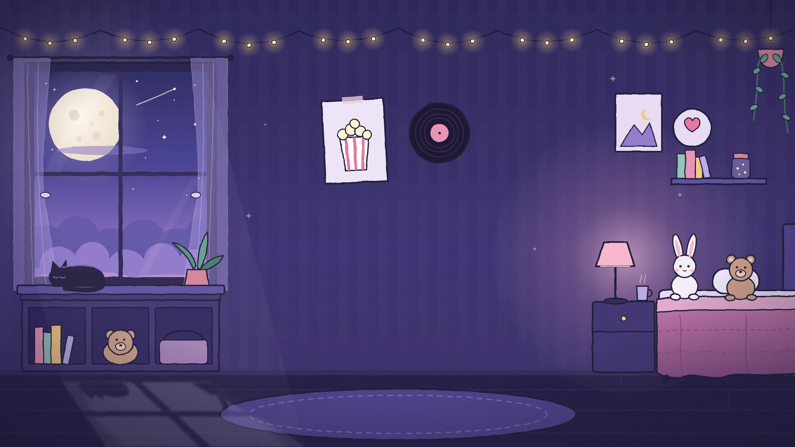

<p align="center">
  
</p>

<h1 align="center">Movie Night</h1>

<p align="center">
  <em>one movie. tonight. no endless scrolling.</em>
</p>

<p align="center">
  
  
  
  
  
</p>

<p align="center">
  
</p>

Movie Night answers one question: **what are we watching tonight?**

Instead of a wall of forty suggestions, it hands you **one ticket**: a single
movie that's streaming on a service someone watching actually has, picked from
what you (and the people you share lists with) have liked. Not feeling it?
Tear it up and pick another.

```
 .------------------------------------------.-----------.
 |  ADMIT ONE                  MOVIE NIGHT  :           |
 |                                          :  TONIGHT  |
 )  What are we watching tonight?           :           (
 |  One movie. On your services.            :    No.    |
 |  Picked for your taste.                  :   0001    |
 '------------------------------------------'-----------'
```

Live at [movienighttf.vercel.app](https://movienighttf.vercel.app) (invite-only, so it's just a login screen for now).

---

## Now showing

- **Recommend a movie.** One button. Tick a mood or two and who's watching if you like, and out comes one movie, with the reason stamped on it ("Because you liked Arrival", "On your Weekend list").
- **Same link, same movie.** Each pick has its own little seed of luck in the URL, so reloading or sharing it never swaps the movie. "Pick another" shuffles again.
- **Rate what you've seen.** Liked it, Not for me, or Haven't seen. The more you rate, the better it knows your taste.
- **Lists for two (or more).** Share a list and see who has already seen each movie on it.
- **Look anything up.** Search any movie and see where it's streaming right now.
- **Your services.** Pick the streaming services you have, and recommendations stick to them.

## How tonight's pick is chosen

1. **Gather** candidates: movies like the ones you've liked, popular movies on your services (in the moods you ticked), movies on your lists, and movies liked by a list-mate who isn't watching.
2. **Skip** anything someone watching has already rated.
3. **Score** the rest. A friend's like counts the most, then "if you liked this" matches, your lists, the genres you lean toward, TMDB's rating, and a pinch of luck. A friend's "not for me" pushes a movie down.
4. **Check** the top few for where they stream, until one is on a service someone watching has.
5. **Print** the ticket.

The scoring rules live in [`lib/recommend-rules.ts`](lib/recommend-rules.ts) and have their own unit tests.

## Behind the curtain

| | |
|---|---|
| **Framework** | Next.js 16 (App Router), React 19, TypeScript |
| **Styling** | Tailwind CSS v4 with design tokens, League Gothic + DM Mono |
| **Data + login** | Supabase: Postgres, email and password sign-in, Row Level Security on every table |
| **Movies** | The TMDB API (where-to-watch data by JustWatch) |
| **Hosting** | Vercel, deployed by GitHub Actions |

## Lights, camera, localhost

You'll need Node 24 (what CI uses), a Supabase project, and a free [TMDB API read token](https://www.themoviedb.org/settings/api).

**1. Install**

```bash
npm ci
```

**2. Add your keys** in a `.env.local` file at the project root:

| Variable | What it is |
|---|---|
| `NEXT_PUBLIC_SUPABASE_URL` | Your Supabase project URL (just the base, no `/rest/v1`) |
| `NEXT_PUBLIC_SUPABASE_PUBLISHABLE_KEY` | Supabase publishable key |
| `SUPABASE_SECRET_KEY` | Supabase secret key. Server only: it saves movies to the shared cache |
| `TMDB_READ_TOKEN` | TMDB API read access token. Server only |

**3. Set up the database** (link your project once, then apply the migrations):

```bash
npx supabase link --project-ref <your-project-ref>
```

```bash
npx supabase db push
```

Sign-ups are turned off (it's invite-only), so add accounts in the Supabase dashboard under Authentication, Users, Add user, with Auto Confirm on.

**4. Roll film**

```bash
npm run dev
```

Then open [localhost:3000](http://localhost:3000).

### Backstage scripts

| Command | What it does |
|---|---|
| `npm run dev` | Dev server with hot reload |
| `npm run build` / `npm start` | Production build, then serve it |
| `npm run lint` | ESLint |
| `npm run typecheck` | Generates Next's route types, then runs TypeScript |
| `npm test` | Unit tests for the recommendation rules |
| `npm run test:db -- --local` | Row Level Security tests against a local Supabase (needs Docker and `npx supabase start` first) |

## The projection booth

Every change goes through a pull request, and [GitHub Actions](.github/workflows/ci.yml) checks it:

- **Every pull request:** lint, type-check, unit tests and a production build, plus the migrations and RLS tests on a throwaway local Supabase (skipped when nothing database-related changed).
- **Merging to main:** new migrations go to the production database first, then the app deploys to Vercel. Only the pipeline deploys production.
- **Twice a day:** a [health check](.github/workflows/health-check.yml) pings `/api/health`, which also keeps the free Supabase project from napping.

## Floor plan

```
app/                         the pages: home, pick, movie, lists, rate, settings, login
  ui.ts, ticket.tsx          shared ticket pieces (bands, perforations, notches)
lib/
  tmdb.ts                    TMDB helpers
  recommender.ts             loads everything a pick needs
  recommend-rules.ts         the scoring rules (+ unit tests)
supabase/
  migrations/                the database, one step at a time
  tests/                     Row Level Security tests
design-system/movie-night/   the look: colors, fonts, tickets (MASTER.md)
scripts/                     CI helpers, the DB test runner, the icon maker
```

## Credits roll

- Movie data and posters come from [TMDB](https://www.themoviedb.org). This product uses the TMDB API but is not endorsed or certified by TMDB.
- Where-to-watch availability is provided by [JustWatch](https://www.justwatch.com).
- Fonts: [League Gothic](https://fonts.google.com/specimen/League+Gothic) and [DM Mono](https://fonts.google.com/specimen/DM+Mono) (SIL Open Font License).
- Icons: [Lucide](https://lucide.dev).
- The room illustration is original, inspired by Lofi Night by redtreacle.

<p align="center">
  <sub>- - - - - - - - - - - - keep your stub - - - - - - - - - - - -</sub>
  <br />
  <sub>made for movie nights, with extra butter</sub>
</p>
